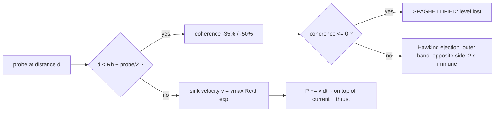
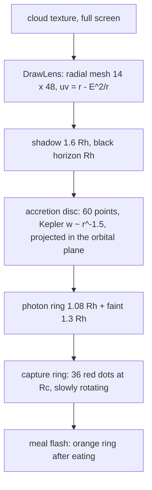

# 01 — Black holes (design)

## 1. ทำไมต้องเป็นหลุมดำ

เวอร์ชัน 1 มีอุปสรรคแค่ 2 อย่าง คือกระแส (ทิศทาง) และ radial node (ระยะทาง) ซึ่งทั้งคู่ **สมมาตรรอบแกน z** ผู้เล่นจึงเรียนรู้ได้ว่า "วงนี้ไปทางนี้" แล้วก็จบ หลุมดำ **ทำลายความสมมาตรนั้น**: มีจุดอันตรายเฉพาะที่ ที่เคลื่อนที่ได้ และเปลี่ยนทิศเมื่อพลิก spin ทำให้การตัดสินใจทุกครั้ง (ไปทางไหน / พลิก spin ไหม / เสี่ยงเก็บที่ขอบหลุมไหม) ยากขึ้น

## 2. แบบจำลอง

| ปริมาณ | ค่า | เหตุผล |
|---|---|---|
| ความเร็วดูด | `vmax · Rc / d · exp(−(max(0, d − Rc) / 3Rc)²)` สูงสุด 1.2 RView/s | ใช้ "ความเร็ว" ไม่ใช่ "ความเร่ง" ให้เข้ากับเกมที่กระแสเป็น velocity field อยู่แล้ว · 1/d คือ sink 2 มิติ · exp ตัดแรงที่ระยะไกล |
| Rc | ระยะที่แรงดูด = ความเร็ว probe (0.34 RView/s) | เส้นแบ่ง "หนีได้ / หนีไม่ได้" ที่ชัดเจน วาดเป็นวงจุดแดง |
| Rh | 0.45 Rc | มีช่วงระหว่าง Rh–Rc ที่กำลังตก ให้เห็นว่าพลาดแล้ว |
| ลอยตามกระแส | ω_hole = 0.35 (0.6) × ω(s, σ) | หลุมดำเป็นส่วนหนึ่งของ orbital ใช้กระแสของ spin ปัจจุบัน → พลิก spin = หลุมดำหันทิศ |
| Hawking ejection | แถบนอกสุด, ตรงข้ามกับหลุม, อมตะ 2 s | ไม่ตายทันที (ลงโทษด้วย coherence + เวลา) และป้องกันการถูกดูดซ้ำทันที |
| กิน quanta | quantum < 1.3 Rh → หาย, เกิดใหม่ที่อื่น | หลุมดำแย่งของ · SINGULARITY: Rc ×1.08 ต่อการกิน 1 ครั้ง (สูงสุด 0.14 RView) เกมจึงยากขึ้นเรื่อย ๆ ถ้าช้า |
| EDGE x2 | เก็บในระยะ 2.5 Rc | ให้รางวัลการเสี่ยง (แรงดูดที่ 2.5 Rc ≈ 0.11 RView/s ยังหนีได้สบาย) |

## 3. การวาด

- lensing ใช้ `SDL_RenderGeometry` กับ texture ของ cloud ที่ render ไว้แล้ว จึงแทบไม่เสียเวลา (fps เท่าเดิม 58)
- `f = (1 − (r/RL)²)²` ทำให้ระยะเลื่อนเป็น 0 ที่ขอบเลนส์ ภาพจึงต่อกับส่วนที่ไม่ผ่านเลนส์ได้พอดี
- ภายใน Einstein radius (r < E) ค่า `r − E²/r` ติดลบ ภาพจึงกลับด้าน (เหมือนภาพที่สองของเลนส์จริง) แต่ถูกเงาดำบังเกือบหมด

## 4. บอท (ใช้ทดสอบ balance และ attract mode)

- หักแรงดูดออกจากความเร็วที่ต้องการ (`v −= 1.5 · sink`)
- ถ้าเข้าใกล้กว่า 3.5 Rc จะเพิ่มแรงผลักออกจากหลุมแบบเส้นตรงตามระยะ
- quantum ที่อยู่ในระยะ 1.8 Rc จากหลุมจะถูกนับว่าไกลขึ้น 4 เท่า (เลือกเป็นอย่างสุดท้าย)

## 5. ค่าที่ปรับได้ (`uPauliGame.pas`, ส่วน `const`)

| ค่า | ปัจจุบัน | ผล |
|---|---|---|
| `BHCountTab` | (0…), (1 1 2 2 3 3), (2 2 3 3 4 5) | จำนวนหลุมดำต่อด่าน / โหมด |
| `BHRc` | 0, 0.075, 0.09 | ขนาดวงที่หนีไม่ได้ |
| `BHDrift` | 0, 0.35, 0.6 | ความเร็วลอยเทียบกับกระแส |
| `BHHit` | 0, 0.35, 0.5 | coherence ที่เสียต่อครั้ง |
| `BHGrow`, `BHRcMax` | 1.08, 0.14 | การโตของ SINGULARITY |
| `ImmuneTime` | 2.0 s | ช่วงอมตะหลัง ejection |
| `EdgeFactor` | 2.5 | ระยะของ EDGE x2 (หน่วย Rc) |

ทุกครั้งที่แก้ให้รัน `app/tests/game_test` เพื่อดูอัตราชนะของบอทใหม่ (ตอนนี้ CLASSIC 18/18 · BLACK HOLE 16/18 · SINGULARITY 14/18)

## 6. ต่อยอด

| งาน | เหตุผล |
|---|---|
| ให้คนจริงเล่นแล้วปรับ `BHRc` / `BHDrift` | balance มาจากบอทเท่านั้น |
| หลุมดำคู่ (binary) ที่โคจรรอบกัน | lensing รวมกัน + แรงดูดสองทิศ |
| Hawking radiation: หลุมเล็กระเหยหายตามเวลา ถ้าไม่ได้กิน | ทำให้ SINGULARITY มีทางชนะแบบ "อดอาหารหลุม" |
| เก็บ quantum ให้หลุมดำกินโดยตั้งใจเพื่อ "เลี้ยง" ให้ใหญ่ไปกินหลุมอื่น (merger) | กลไกเชิงกลยุทธ์ |
| ใช้ lensing กับ inset traditional orbital ด้วย | ความสวยงาม |
